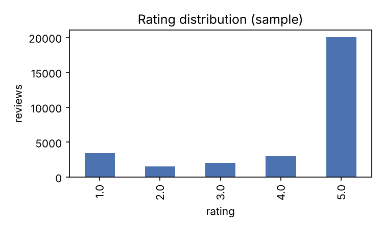
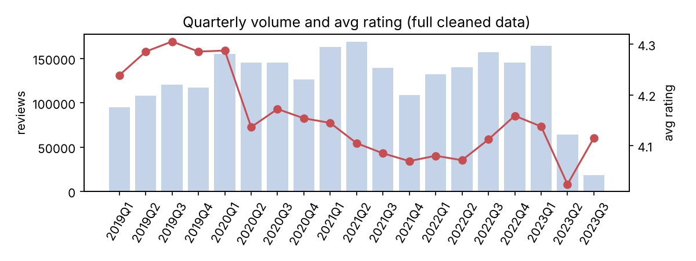

# 数据背景：Amazon Reviews 2023 · Beauty & Personal Care · 护肤

## 清洗漏斗

| 步骤 | 剩余评论数 |
|---|---|
| Beauty_and_Personal_Care 全部评论 | 23,911,390 |
| 护肤子品类 | 4,722,502 |
| 护肤 · 2019 年以后 | 2,688,202 |
| 去空文本 | 2,684,843 |
| 限定 2019–2023 | 2,684,843 |
| 去重 | 2,658,782 |
| 去掉 <20 字符 | 2,416,658 |
| 随机抽样（分析主样本） | 30,000 |

## 分析主样本概况

- 评论数：30,000；商品数：14,021；品牌数：4,970；用户数：29,182
- 时间：2019-01-01 至 2023-09-04
- 平均评分 4.16；差评（≤2 星）占比 16.4%
- 认证购买占比 89.5%；带图评论占比 5.9%
- 评论长度中位数 128 字符；有品牌信息 98.0%；有价格信息 77.7%

## 评分分布

| 星级 | 条数 | 占比 |
|---|---|---|
| 1 | 3,399 | 11.3% |
| 2 | 1,520 | 5.1% |
| 3 | 2,053 | 6.8% |
| 4 | 2,984 | 9.9% |
| 5 | 20,044 | 66.8% |

## 价格段

| 价格段 | 条数 | 平均评分 |
|---|---|---|
| 中价 | 8,664 | 4.20 |
| 低价 | 9,663 | 4.15 |
| 未知 | 6,700 | 4.14 |
| 高价 | 4,973 | 4.13 |

## 评论量 Top 15 品牌

| 品牌 | 评论数 | 平均评分 | 差评率 |
|---|---|---|---|
| Neutrogena | 780 | 4.05 | 19.6% |
| CeraVe | 459 | 3.94 | 21.1% |
| Olay | 408 | 4.12 | 18.1% |
| Burt's Bees | 367 | 4.25 | 14.4% |
| Dove | 347 | 4.24 | 15.6% |
| Aveeno | 316 | 4.17 | 17.1% |
| Bath & Body Works | 304 | 4.31 | 13.8% |
| L’Oréal Paris | 303 | 4.01 | 20.1% |
| NIVEA | 266 | 4.17 | 16.2% |
| TruSkin Naturals | 266 | 4.17 | 16.9% |
| Dr. Squatch | 248 | 3.68 | 26.6% |
| Dial | 220 | 4.12 | 16.8% |
| Palmer's | 203 | 4.30 | 13.3% |
| Hempz | 202 | 4.28 | 14.9% |
| Tree of Life Beauty | 190 | 4.32 | 12.6% |

## 二级品类

| 品类 | 条数 | 平均评分 |
|---|---|---|
| Body | 12,323 | 4.20 |
| Face | 11,318 | 4.17 |
| Sunscreens & Tanning Products | 3,149 | 3.96 |
| Lip Care | 1,895 | 4.22 |
| Eyes | 932 | 3.99 |
| Sets & Kits | 275 | 4.20 |
| Maternity | 24 | 4.38 |

## 末级品类 Top 15

| 品类 | 条数 | 平均评分 |
|---|---|---|
| Soaps | 2,611 | 4.19 |
| Lotions | 2,568 | 4.25 |
| Face Moisturizers | 2,542 | 4.18 |
| Body Washes | 2,114 | 4.14 |
| Serums | 1,816 | 4.13 |
| Masks | 1,697 | 4.13 |
| Balms & Moisturizers | 1,662 | 4.26 |
| Washes | 1,424 | 4.19 |
| Hand Wash | 1,340 | 4.15 |
| Creams | 1,222 | 4.19 |
| Oils | 1,209 | 4.20 |
| Sets & Kits | 906 | 4.21 |
| Body Sunscreens | 849 | 3.95 |
| Facial Sunscreens | 782 | 3.91 |
| Body Butters | 762 | 4.19 |

